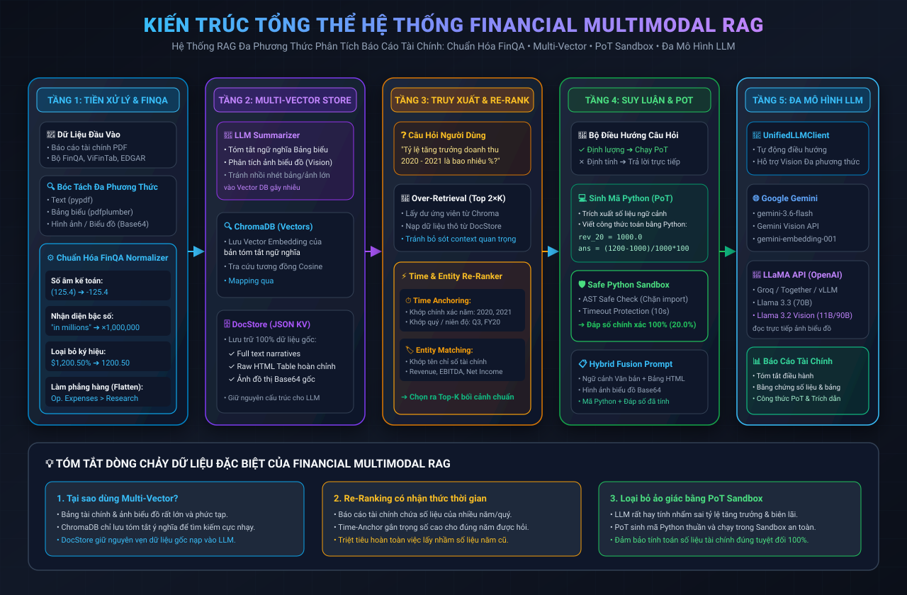
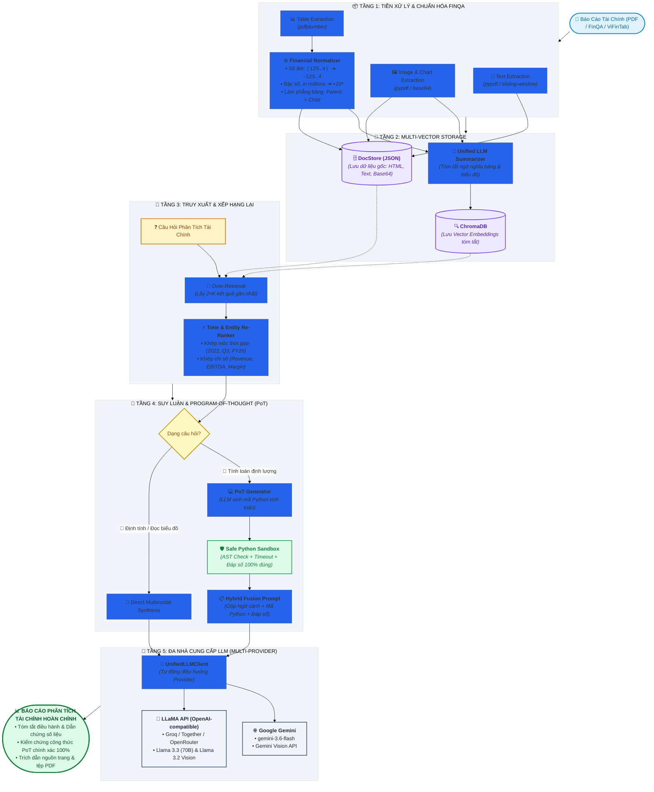

# Financial Multimodal RAG

Hệ thống **Retrieval-Augmented Generation (RAG) Đa phương thức** chuyên sâu cho phân tích báo cáo tài chính (Báo cáo thường niên, Báo cáo tài chính Quý/Năm, 10-K, SEC filings, bảng cân đối kế toán).

Hệ thống kết hợp sức mạnh của **Multi-Vector Retriever**, **Chuẩn hóa dữ liệu đặc thù FinQA**, **Context Re-ranking**, **Program-of-Thought (PoT) với Python Sandbox**, và hỗ trợ linh hoạt **Đa mô hình LLM (Google Gemini & LLaMA API)**.

---

## 🏛️ Sơ Đồ Kiến Trúc Tổng Thể (System Architecture)

> 📖 **Xem tài liệu kiến trúc chuyên sâu bằng tiếng Việt**: 👉 [**KIEN_TRUC.md**](KIEN_TRUC.md)



### 1. Sơ Đồ Trực Quan Đồ Họa (Interactive Mermaid Diagram)



---

### 2. Luồng Xử Lý 5 Bước Cốt Lõi (Pipeline at a Glance)

> 🔹 **Bước 1 — Ingestion & Chuẩn Hóa FinQA**:
> Bóc tách song song Văn bản, Bảng biểu và Đồ thị. Bảng biểu được chuyển sang HTML và đưa qua bộ chuẩn hóa kế toán (chuyển số âm `(x)` $\rightarrow$ `-x`, bóc tách quy mô `"in millions"`, làm phẳng danh mục `Parent > Child`).

> 🔹 **Bước 2 — Lưu Trữ Multi-Vector (ChromaDB + DocStore)**:
> Thay vì nhét toàn bộ bảng/ảnh lớn vào vector store (dễ gây nhiễu), hệ thống dùng LLM tóm tắt ý nghĩa cốt lõi của bảng/ảnh để lưu vector vào **ChromaDB**, trong khi toàn bộ dữ liệu gốc được lưu an toàn trong **DocStore**.

> 🔹 **Bước 3 — Truy Xuất & Re-ranking Có Nhận Thức Thời Gian**:
> Khi người dùng đặt câu hỏi, hệ thống lấy gấp đôi lượng context cần thiết, sau đó chấm điểm lại dựa trên **Mốc thời gian (Năm, Quý, FY)** và **Tên chỉ số tài chính (Doanh thu, Lợi nhuận, EBITDA)** để loại bỏ hoàn toàn các thông tin lạc đề.

> 🔹 **Bước 4 — Tính Toán Chính Xác với Program-of-Thought (PoT)**:
> Với các câu hỏi tính toán tăng trưởng hay tỷ lệ, thay vì để LLM đoán mò kết quả (dễ bị sai), mô hình sẽ viết code Python và chuyển vào **Sandbox an toàn** chạy thực tế để lấy đáp số chuẩn 100%.

> 🔹 **Bước 5 — Tổng Hợp Bằng Đa Mô Hình (Gemini hoặc LLaMA API)**:
> Tầng trừu tượng `UnifiedLLMClient` cho phép gửi câu hỏi cùng toàn bộ bằng chứng (ảnh biểu đồ, bảng HTML, đáp số tính toán) tới **Google Gemini** hoặc **mô hình LLaMA (Groq, Together AI, OpenRouter)** để sinh báo cáo phân tích chuyên sâu.

---

### 3. Bảng Ma Trận Kiến Trúc Hệ Thống (Architecture Matrix)

| Tầng (Layer) | Thành Phần Chính | Chức Năng Cốt Lõi | File Nguồn Liên Quan |
| :--- | :--- | :--- | :--- |
| **1. Ingestion & Normalization** | `DocumentLoader`<br/>`FinancialNormalizer` | • Trích xuất Text, Table, Chart từ PDF<br/>• Chuẩn hóa số âm `(125) ➔ -125`<br/>• Bóc tách quy mô tiền tệ & Làm phẳng hàng | [`document_loader.py`](src/financial_rag/ingestion/document_loader.py)<br/>[`financial_normalizer.py`](src/financial_rag/ingestion/financial_normalizer.py) |
| **2. Multi-Vector Storage** | `MultimodalSummarizer`<br/>`ChromaDB` & `DocStore` | • Sinh tóm tắt ngữ nghĩa bảng biểu & đồ thị<br/>• Lưu Vector Embeddings phục vụ tìm kiếm<br/>• Lưu giữ liệu thô (HTML/Text/Base64) | [`multimodal_summarizer.py`](src/financial_rag/reasoning/multimodal_summarizer.py)<br/>[`vector_store.py`](src/financial_rag/retrieval/vector_store.py)<br/>[`doc_store.py`](src/financial_rag/retrieval/doc_store.py) |
| **3. Retrieval & Re-ranking** | `ContextReRanker` | • Over-retrieval (Lấy 2×K tài liệu)<br/>• Time Anchoring (Khớp năm 2021, Q3, FY)<br/>• Financial Entity Matching (Doanh thu, Margin) | [`reranker.py`](src/financial_rag/retrieval/reranker.py) |
| **4. Reasoning & PoT** | `ProgramOfThoughtEngine`<br/>`ExecutionSandbox` | • Phát hiện câu hỏi định lượng số học<br/>• Sinh Python code tính toán từng bước<br/>• Chạy trong Sandbox an toàn (AST validator) | [`pot_reasoning.py`](src/financial_rag/reasoning/pot_reasoning.py)<br/>[`sandbox.py`](src/financial_rag/reasoning/sandbox.py) |
| **5. Multi-Provider Engine** | `UnifiedLLMClient`<br/>`FinancialQAEngine` | • Chuyển đổi linh hoạt **Gemini** & **LLaMA API**<br/>• Hỗ trợ Vision đọc biểu đồ đa phương thức<br/>• Tổng hợp báo cáo phân tích có trích dẫn | [`llm_client.py`](src/financial_rag/reasoning/llm_client.py)<br/>[`financial_qa.py`](src/financial_rag/reasoning/financial_qa.py) |

---

## 🚀 Các Tính Năng Nổi Bật

1. **Chuẩn Hóa Dữ Liệu Tài Chính FinQA ([`financial_normalizer.py`](src/financial_rag/ingestion/financial_normalizer.py))**:
   - Tự động chuyển đổi số âm trong kế toán: `(125.4)` $\rightarrow$ `-125.4`.
   - Bóc tách hệ số quy mô: `"in millions"` $\rightarrow$ nhân $10^6$, `"in thousands"` $\rightarrow$ nhân $10^3$, hỗ trợ cả tiếng Việt (*"tỷ đồng"*, *"triệu đồng"*).
   - **Làm phẳng tiêu đề hàng (Flattened Row Headers)**: Tự động gán tiền tố nhóm cấp cha vào từng mục con (ví dụ: `Operating Expenses > Research`), giải quyết triệt để vấn đề nhầm lẫn giữa các chỉ tiêu có tên tương đồng trong bảng tài chính.

2. **Context Re-ranking & Time Anchoring ([`reranker.py`](src/financial_rag/retrieval/reranker.py))**:
   - Truy xuất dư (Over-retrieval) và xếp hạng lại bằng thuật toán kết hợp Time Anchoring (nhận diện chính xác năm 2021, 2022, Q1, Q3, FY2023) và Entity Matching (Revenue, EBITDA, Net Income, Gross Margin).
   - Đảm bảo mô hình luôn nhận đúng bối cảnh của kỳ tài chính được hỏi.

3. **Program-of-Thought (PoT) Reasoning ([`pot_reasoning.py`](src/financial_rag/reasoning/pot_reasoning.py))**:
   - Giải quyết triệt để hiện tượng "ảo giác số học" (arithmetic hallucination) của LLM.
   - Khi gặp câu hỏi tính toán tỷ lệ tăng trưởng, biên lợi nhuận, chênh lệch: LLM sẽ viết code Python và chuyển vào **Python Execution Sandbox** an toàn ([`sandbox.py`](src/financial_rag/reasoning/sandbox.py)) với AST validator và timeout protection để tính toán chính xác 100%.

4. **Kiến Trúc Đa Nhà Cung Cấp (Multi-Provider LLM Engine) ([`llm_client.py`](src/financial_rag/reasoning/llm_client.py))**:
   - Chuyển đổi linh hoạt giữa **Google Gemini** và **mô hình LLaMA qua API** (tương thích giao thức OpenAI: Groq, Together AI, OpenRouter, vLLM, Ollama).
   - Hỗ trợ đầy đủ **Vision Đa phương thức** với `gemini-3.6-flash` hoặc `llama-3.2-11b-vision-preview` / `llama-3.2-90b-vision-preview` để đọc trực tiếp đồ thị và biểu đồ.

5. **Multi-Vector Retriever Pattern**:
   - Lưu trữ embedding của các bản tóm tắt giàu ngữ nghĩa trong **ChromaDB**.
   - Lưu toàn bộ dữ liệu thô (Raw HTML tables, Full Text, Base64 Images) trong **DocStore** để nạp vào LLM khi sinh câu trả lời.

---

## 🛠️ Cài Đặt & Cấu Hình

### 1. Yêu Cầu Hệ Thống & Cài Đặt Thư Viện

Khuyến nghị Python 3.11 trở lên:

```powershell
# Di chuyển vào thư mục dự án
cd d:\Financial-Multimodal-RAG-main\Financial-Multimodal-RAG-main

# Kích hoạt môi trường ảo (nếu có)
.\.venv\Scripts\Activate.ps1

# Cài đặt các gói phụ thuộc
pip install -r requirements.txt
pip install -e .
```

### 2. Cấu Hình File `.env`

Tạo file `.env` từ file mẫu [`.env.example`](.env.example):

```powershell
copy .env.example .env
```

#### Tùy Chọn A: Sử dụng mô hình LLaMA qua API (Groq - Cực nhanh & Miễn phí)

```env
# Kích hoạt nhà cung cấp LLaMA
LLM_PROVIDER=llama

# Groq API endpoint
LLAMA_BASE_URL=https://api.groq.com/openai/v1
LLAMA_API_KEY=gsk_your_groq_api_key_here

# Chọn model LLaMA:
# - llama-3.3-70b-versatile: Dành cho text, bảng biểu và toán tài chính
# - llama-3.2-11b-vision-preview: Dành cho câu hỏi cần đọc biểu đồ/ảnh
LLAMA_CHAT_MODEL=llama-3.3-70b-versatile

# Dùng key Gemini cho khâu Vector Embedding
GEMINI_API_KEY=your_gemini_api_key_here
```

*(Hoặc dùng với **OpenRouter**: `LLAMA_BASE_URL=https://openrouter.ai/api/v1` và `LLAMA_CHAT_MODEL=meta-llama/llama-3.3-70b-instruct`)*.

#### Tùy Chọn B: Sử dụng Google Gemini gốc

```env
LLM_PROVIDER=gemini
GEMINI_API_KEY=your_gemini_api_key_here
EMBEDDING_MODEL=gemini-embedding-001
CHAT_MODEL=gemini-3.6-flash
```

---

## 💻 Hướng Dẫn Sử Dụng

### 1. Sử Dụng Qua Giao Diện Dòng Lệnh (CLI)

**A. Nạp và lập chỉ mục báo cáo tài chính (PDF):**
```powershell
python -m financial_rag.cli ingest data/raw/sample_report.pdf
```

**B. Nạp bộ dữ liệu chuẩn (FinQA / ViFinTab / SEC-EDGAR):**
```powershell
python -m financial_rag.cli ingest-dataset data/raw/datasets/huggingface/ViFinTab_parquet
```

**C. Đặt câu hỏi phân tích tài chính:**
```powershell
python -m financial_rag.cli ask "Tốc độ tăng trưởng doanh thu từ năm 2020 đến 2021 là bao nhiêu?"
```

**D. Bật cờ ép buộc tính toán chính xác với Program-of-Thought (`--pot`):**
```powershell
python -m financial_rag.cli ask "Tính biên lợi nhuận hoạt động trong quý 3?" --pot
```
*Kết quả sẽ in ra mã code Python do LLM sinh ra, kết quả tính toán trong Sandbox và lời giải thích chi tiết.*

---

### 2. Sử Dụng Qua REST API (FastAPI)

Khởi động server:
```powershell
python -m financial_rag.cli serve --port 8000
```
Truy cập tài liệu Swagger UI tại: `http://127.0.0.1:8000/docs`.

**Gửi câu hỏi phân tích qua `POST /api/v1/ask`:**
```json
{
  "question": "What is the percentage growth in net income between 2018 and 2019?",
  "limit": 6,
  "use_pot": true
}
```

**Phản hồi API:**
```json
{
  "answer": "Net income grew by 18.25% from $400M in 2018 to $473M in 2019...",
  "generated_code": "net_income_2018 = 400.0\nnet_income_2019 = 473.0\nans = round((net_income_2019 - net_income_2018) / net_income_2018 * 100, 2)",
  "computed_answer": 18.25,
  "pot_success": true,
  "retrieved_tables": [...],
  "retrieved_images": [...]
}
```

---

## 🧪 Chạy Kiểm Thử (Tests)

Toàn bộ test suite bao gồm 95 tests kiểm thử tự động toàn diện:

```powershell
python -m pytest tests/ -v
```

Các module kiểm thử chính:
- [`test_financial_normalizer.py`](tests/test_financial_normalizer.py): Kiểm thử chuẩn hóa số âm, ký hiệu tiền tệ, scale factor, làm phẳng hàng.
- [`test_llm_client.py`](tests/test_llm_client.py): Kiểm thử tích hợp đa nhà cung cấp (LLaMA API + Vision + Gemini).
- [`test_pot_sandbox.py`](tests/test_pot_sandbox.py): Kiểm thử sandbox an toàn, chặn mã độc, PoT arithmetic solver.
- [`test_reranker.py`](tests/test_reranker.py): Kiểm thử trích xuất Time Anchors và Re-ranking.
- [`test_reasoning_multimodal.py`](tests/test_reasoning_multimodal.py): Kiểm thử prompt fusion và xử lý ảnh đa phương thức.

---

## 📁 Cấu Trúc Dự Án

```text
financial-multimodal-rag/
├── src/financial_rag/
│   ├── api/
│   │   └── main.py                  # FastAPI REST API endpoints
│   ├── config/
│   │   └── settings.py              # Cấu hình đa nhà cung cấp (Gemini & LLaMA)
│   ├── ingestion/
│   │   ├── dataset_adapters.py      # Bộ nạp dữ liệu FinQA, ViFinTab, SEC-EDGAR
│   │   ├── document_loader.py       # Trích xuất Text, HTML Tables, và Images từ PDF
│   │   ├── financial_normalizer.py  # Chuẩn hóa giá trị tài chính & Flatten Row Headers
│   │   ├── models.py                # Pydantic Data models (DocumentElement, Chunk)
│   │   └── ocr.py                   # OCR fallback hook
│   ├── reasoning/
│   │   ├── financial_qa.py          # Multimodal QA Engine tích hợp Re-ranking & PoT
│   │   ├── llm_client.py            # Unified LLM Client (Gemini & LLaMA API Vision)
│   │   ├── multimodal_summarizer.py # Tóm tắt ngữ nghĩa cho Text, Tables và Images
│   │   ├── pot_reasoning.py         # Program-of-Thought reasoning engine
│   │   └── sandbox.py               # Safe Python Execution Sandbox với AST check
│   ├── retrieval/
│   │   ├── chunking.py              # Chiến lược phân đoạn đa phương thức
│   │   ├── doc_store.py             # Kho lưu trữ dữ liệu thô (JSON KV-store)
│   │   ├── reranker.py              # Time Anchoring & Entity-aware Context Re-ranker
│   │   └── vector_store.py          # ChromaDB Multi-Vector Store & Embedding
│   ├── pipeline.py                  # Điều phối pipeline Ingest và Query
│   └── cli.py                       # Rich CLI interface (hỗ trợ --pot)
├── tests/                           # 95 Unit & Integration tests
├── requirements.txt                 # Danh mục thư viện phụ thuộc
├── .env.example                     # Mẫu cấu hình môi trường chuẩn
└── README.md                        # Tài liệu hướng dẫn & kiến trúc hệ thống
```

---

## 📄 Bản Quyền (License)

Dự án được phân phối dưới giấy phép **MIT License**.
